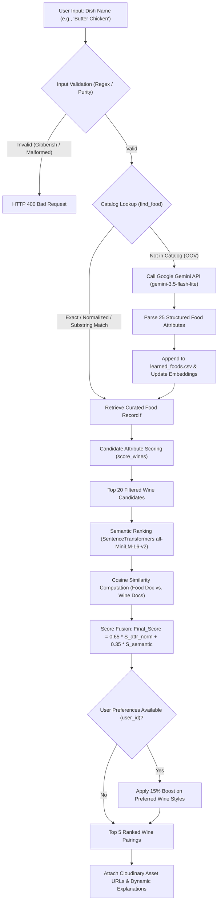

# VinoSphere — Food–Wine Pairing Recommendation Module
## Comprehensive Research Audit, Technical Architecture & Academic Publication Assessment

**Paper Working Title**: *An Explainable and Culturally-Aware Indian Food–Wine Recommendation Framework Using a Self-Curated Dataset*  
**Audit Type**: Read-Only Source Code & Dataset Research Audit  
**Target Publication Venues**: IEEE Transactions on Knowledge and Data Engineering / IEEE Access / ACM RecSys / International Conference on Machine Learning and Applications (ICMLA)  
**System Analyzed**: VinoSphere Digital Viticulture & Sommelier Ecosystem  
**Focus Subsystem**: Dedicated Food–Wine Pairing Recommendation Engine & Indian Culinary Dataset  
**Audit Timestamp**: October 2026  

---

## Executive Summary

This research audit delivers an exhaustive, code-level analysis of the **Food–Wine Pairing Recommendation Module** within the VinoSphere platform. The audit was conducted in a strict read-only manner, verifying existing application logic, mathematical scoring formulations, datasets, vector indexes, and offline evaluation protocols.

### Key Audit Findings:
1. **Core Architecture**: The pairing engine is implemented as a bidirectional, hybrid recommendation microservice in Python (FastAPI, [`backend/ml-services/food-recommendation`](file:///c:/Users/Gayatri/OneDrive/Desktop/FYP/good%20ui/backend/ml-services/food-recommendation)) combined with an asynchronous Google Gemini LLM fallback for zero-shot dynamic profiling of out-of-vocabulary (OOV) dishes, and a resilient browser-side Sommelier rule engine in TypeScript ([`frontend/consumer/lib/food-pairing`](file:///c:/Users/Gayatri/OneDrive/Desktop/FYP/good%20ui/frontend/consumer/lib/food-pairing)).
2. **Recommendation Formulation**: The active recommendation algorithm computes a linear combination of a heuristic sommelier attribute compatibility score ($S_{\text{attr}}$) and dense semantic cosine similarity ($S_{\text{semantic}}$) generated via a 384-dimensional SentenceTransformer (`all-MiniLM-L6-v2`) over canonical document representations.
3. **Dataset Provenance**: The system is powered by two self-curated datasets: `food_clean.csv` ($N = 499$ dishes $\times 27$ attributes, of which $38.1\%$ are authentic Indian regional dishes spanning 15+ sub-cuisines) and `wine_clean.csv` ($M = 300$ wines $\times 26$ attributes, comprising commercial Indian wines from 22 verified wineries in Maharashtra and Karnataka).
4. **Experimental Reality**: No offline ranking evaluation (Precision@K, Recall@K, NDCG@K, MAP@K) or formal double-blind sommelier panel evaluation was calculated for the food-wine pairing module on an independent ground-truth test dataset. Prior benchmark scripts in the repository (`run_integrated_evaluation.ts`) explicitly document this as `LIMITATION_DOCUMENTED`.
5. **Research Viability**: The framework possesses strong conceptual novelty in its cultural adaptation to Indian culinary sensory profiles (spice levels, gravies, ghee/fats, vegetarian/Jain constraints) and Indian viticulture. However, **to pass peer review in an IEEE or ACM venue, an empirical offline evaluation against a curated benchmark test set (or sommelier agreement study) is mandatory.**

---

## 1. Existing System Overview

The VinoSphere Food–Wine Pairing Recommendation System addresses a significant gap in conventional computational gastronomy and recommender systems: mainstream platforms (e.g., Vivino, Delectable, CellarTracker) are overwhelmingly calibrated toward Western cuisines (cheese, steaks, pasta) and European/American viticulture, failing to account for the complex spice chemistry, high fat/ghee emulsion, and varied regional culinary profiles of Indian cuisine.

The pairing subsystem in VinoSphere operates as a **two-tier architecture**:
1. **Cloud / Microservice Tier**: A FastAPI service (`port 8000`) that executes two-way matching:
   - **Forward Pairing (Food $\rightarrow$ Wine)**: Maps a chosen culinary dish to ranked wine candidates.
   - **Reverse Pairing (Wine $\rightarrow$ Food)**: Maps a chosen wine bottle/varietal to harmonious food dishes.
   - **Semantic Search**: Dense vector embeddings generated via `all-MiniLM-L6-v2` and indexed via FAISS (`IndexFlatIP`).
   - **Out-Of-Vocabulary (OOV) Knowledge Discovery**: When an unknown dish or wine is queried, the engine validates whether the query is legitimate (filtering out keyboard smashes and vowel-less strings) and dynamically calls Google Gemini (`gemini-3.5-flash-lite` / `gemini-2.0-flash`) to infer 25 structured culinary/enological attributes, persisting learned entities to local CSV files.
2. **Client-Side Edge Tier**: In the consumer Next.js application (`frontend/consumer`), an interactive interface renders dish selection, filters, and pairing cards. In the event of network latency, service disruption, or standalone operation, a client-side sommelier engine ([`pairingEngine.ts`](file:///c:/Users/Gayatri/OneDrive/Desktop/FYP/good%20ui/frontend/consumer/lib/food-pairing/pairingEngine.ts)) executes 8 WSET/Wine Folly-style compatibility rules over static catalog slices.

---

## 2. Complete File Inventory

The table below catalogs every file in the repository associated with the food–wine pairing pipeline, detailing its exact path, role, technology stack, and operational status.

| File Path | Subsystem / Layer | Tech Stack | Role in Pairing System |
| :--- | :--- | :--- | :--- |
| [`backend/ml-services/food-recommendation/api/main.py`](file:///c:/Users/Gayatri/OneDrive/Desktop/FYP/good%20ui/backend/ml-services/food-recommendation/api/main.py) | Python Microservice | FastAPI, Uvicorn | Microservice entry point; registers CORS middleware (`allow_origins=["*"]`) and mounts routes. |
| [`backend/ml-services/food-recommendation/api/routes.py`](file:///c:/Users/Gayatri/OneDrive/Desktop/FYP/good%20ui/backend/ml-services/food-recommendation/api/routes.py) | Python Microservice | FastAPI | Defines REST endpoints: `GET /food-categories`, `GET /foods`, `GET /wine-types`, `GET /wines`, `POST /recommend`, `POST /recommend-food`. |
| [`backend/ml-services/food-recommendation/api/models.py`](file:///c:/Users/Gayatri/OneDrive/Desktop/FYP/good%20ui/backend/ml-services/food-recommendation/api/models.py) | Python Microservice | Pydantic | Schema definitions: `FoodRequest(food_name, user_id)` and `WineRequest(wine_name, user_id)`. |
| [`backend/ml-services/food-recommendation/services/recommendation_engine.py`](file:///c:/Users/Gayatri/OneDrive/Desktop/FYP/good%20ui/backend/ml-services/food-recommendation/services/recommendation_engine.py) | Python Microservice | Pandas, NumPy, Scikit-learn, SentenceTransformers | **Core Recommendation Engine**: Candidate retrieval, attribute compatibility scoring, semantic embedding ranking, user personalization weighting, and OOV Gemini orchestration. |
| [`backend/ml-services/food-recommendation/services/food_catalog_service.py`](file:///c:/Users/Gayatri/OneDrive/Desktop/FYP/good%20ui/backend/ml-services/food-recommendation/services/food_catalog_service.py) | Python Microservice | Pandas, Python RegEx | Multi-attribute taxonomy classification engine; derives 12 human-readable display categories from raw dish records. |
| [`backend/ml-services/food-recommendation/services/wine_catalog_service.py`](file:///c:/Users/Gayatri/OneDrive/Desktop/FYP/good%20ui/backend/ml-services/food-recommendation/services/wine_catalog_service.py) | Python Microservice | Pandas | Dynamic catalog loader; groups wines by style (`Red`, `White`, `Rosé`, `Sparkling`, `Dessert`). |
| [`backend/ml-services/food-recommendation/services/gemini_service.py`](file:///c:/Users/Gayatri/OneDrive/Desktop/FYP/good%20ui/backend/ml-services/food-recommendation/services/gemini_service.py) | Python Microservice | `google-genai` SDK | Zero-shot LLM culinary attribute extractor with structured JSON schema enforcement and retry logic. |
| [`backend/ml-services/food-recommendation/services/cloudinary_image_library.py`](file:///c:/Users/Gayatri/OneDrive/Desktop/FYP/good%20ui/backend/ml-services/food-recommendation/services/cloudinary_image_library.py) | Image Management | Python | Cloudinary asset mapper and cache reader for visual presentation of dishes and bottles. |
| [`backend/ml-services/food-recommendation/services/food_image_matcher.py`](file:///c:/Users/Gayatri/OneDrive/Desktop/FYP/good%20ui/backend/ml-services/food-recommendation/services/food_image_matcher.py) | Image Management | Python | Multi-tiered heuristic and fuzzy matching linking food dish records to Cloudinary image assets. |
| [`backend/ml-services/food-recommendation/services/wine_image_matcher.py`](file:///c:/Users/Gayatri/OneDrive/Desktop/FYP/good%20ui/backend/ml-services/food-recommendation/services/wine_image_matcher.py) | Image Management | Python | Matches wine names and wineries to authentic bottle imagery. |
| [`backend/ml-services/food-recommendation/services/image_service.py`](file:///c:/Users/Gayatri/OneDrive/Desktop/FYP/good%20ui/backend/ml-services/food-recommendation/services/image_service.py) | Image Management | Python, Requests | Asynchronous background image fetcher querying Wikipedia/Unsplash for newly learned items. |
| [`backend/ml-services/food-recommendation/datasets/food_dataset.csv`](file:///c:/Users/Gayatri/OneDrive/Desktop/FYP/good%20ui/backend/ml-services/food-recommendation/datasets/food_dataset.csv) | Data Store | CSV (Raw) | Baseline food database containing 501 raw entries across 27 culinary/sensory attributes. |
| [`backend/ml-services/food-recommendation/datasets/wine_dataset.csv`](file:///c:/Users/Gayatri/OneDrive/Desktop/FYP/good%20ui/backend/ml-services/food-recommendation/datasets/wine_dataset.csv) | Data Store | CSV (Raw) | Baseline Indian wine database containing 300 commercial Indian wines from 22 estates across 26 attributes. |
| [`backend/ml-services/food-recommendation/datasets/learned_foods.csv`](file:///c:/Users/Gayatri/OneDrive/Desktop/FYP/good%20ui/backend/ml-services/food-recommendation/datasets/learned_foods.csv) | Data Store | CSV (Dynamic) | Incremental cache of dishes analyzed via Google Gemini API during live user interaction. |
| [`backend/ml-services/food-recommendation/datasets/learned_wines.csv`](file:///c:/Users/Gayatri/OneDrive/Desktop/FYP/good%20ui/backend/ml-services/food-recommendation/datasets/learned_wines.csv) | Data Store | CSV (Dynamic) | Incremental cache of wines analyzed via Google Gemini API during live user interaction. |
| [`backend/ml-services/food-recommendation/processed_data/food_clean.csv`](file:///c:/Users/Gayatri/OneDrive/Desktop/FYP/good%20ui/backend/ml-services/food-recommendation/processed_data/food_clean.csv) | Processed Data | CSV | Cleaned, deduplicated food dataset ($N = 499$) with standardized categorical dimensions. |
| [`backend/ml-services/food-recommendation/processed_data/wine_clean.csv`](file:///c:/Users/Gayatri/OneDrive/Desktop/FYP/good%20ui/backend/ml-services/food-recommendation/processed_data/wine_clean.csv) | Processed Data | CSV | Cleaned, deduplicated wine dataset ($M = 300$) with normalized structural palate fields. |
| [`backend/ml-services/food-recommendation/processed_data/food_documents.csv`](file:///c:/Users/Gayatri/OneDrive/Desktop/FYP/good%20ui/backend/ml-services/food-recommendation/processed_data/food_documents.csv) | Processed Data | CSV | Food dataset with synthetic natural-language paragraph documents generated per dish. |
| [`backend/ml-services/food-recommendation/processed_data/wine_documents.csv`](file:///c:/Users/Gayatri/OneDrive/Desktop/FYP/good%20ui/backend/ml-services/food-recommendation/processed_data/wine_documents.csv) | Processed Data | CSV | Wine dataset with synthetic natural-language paragraph documents generated per wine. |
| [`backend/ml-services/food-recommendation/embeddings/food_embeddings.npy`](file:///c:/Users/Gayatri/OneDrive/Desktop/FYP/good%20ui/backend/ml-services/food-recommendation/embeddings/food_embeddings.npy) | Embeddings | NumPy (`.npy`) | Precomputed 384-dimensional dense vectors for all 499 food documents (Shape: $499 \times 384$, float32). |
| [`backend/ml-services/food-recommendation/embeddings/wine_embeddings.npy`](file:///c:/Users/Gayatri/OneDrive/Desktop/FYP/good%20ui/backend/ml-services/food-recommendation/embeddings/wine_embeddings.npy) | Embeddings | NumPy (`.npy`) | Precomputed 384-dimensional dense vectors for all 300 wine documents (Shape: $300 \times 384$, float32). |
| [`backend/ml-services/food-recommendation/faiss_index/food.index`](file:///c:/Users/Gayatri/OneDrive/Desktop/FYP/good%20ui/backend/ml-services/food-recommendation/faiss_index/food.index) | Vector Index | FAISS (`IndexFlatIP`) | L2-normalized inner product FAISS index over food vectors (ntotal: 499, d: 384). |
| [`backend/ml-services/food-recommendation/faiss_index/wine.index`](file:///c:/Users/Gayatri/OneDrive/Desktop/FYP/good%20ui/backend/ml-services/food-recommendation/faiss_index/wine.index) | Vector Index | FAISS (`IndexFlatIP`) | L2-normalized inner product FAISS index over wine vectors (ntotal: 300, d: 384). |
| [`frontend/consumer/app/food-pairing/page.tsx`](file:///c:/Users/Gayatri/OneDrive/Desktop/FYP/good%20ui/frontend/consumer/app/food-pairing/page.tsx) | Frontend (Next.js) | React / TypeScript | Canonical Next.js route `/food-pairing` rendering `<FoodPairingApp />`. |
| [`frontend/consumer/app/food-recommendation/page.tsx`](file:///c:/Users/Gayatri/OneDrive/Desktop/FYP/good%20ui/frontend/consumer/app/food-recommendation/page.tsx) | Frontend (Next.js) | React / TypeScript | Alias route `/food-recommendation` rendering `<FoodPairingApp />`. |
| [`frontend/consumer/components/food-pairing/FoodPairingApp.tsx`](file:///c:/Users/Gayatri/OneDrive/Desktop/FYP/good%20ui/frontend/consumer/components/food-pairing/FoodPairingApp.tsx) | Frontend Component | React 19, Framer Motion | Main user interface (70.4 KB, 1,195 lines): dish category carousel, search autocomplete, pairing results cards, sommelier tasting explanations modal. |
| [`frontend/consumer/components/food-pairing/HeroLanding.tsx`](file:///c:/Users/Gayatri/OneDrive/Desktop/FYP/good%20ui/frontend/consumer/components/food-pairing/HeroLanding.tsx) | Frontend Component | React | Hero banner with quick category selection pills and CTA buttons. |
| [`frontend/consumer/lib/food-pairing/recommendationApi.ts`](file:///c:/Users/Gayatri/OneDrive/Desktop/FYP/good%20ui/frontend/consumer/lib/food-pairing/recommendationApi.ts) | Frontend API Client | TypeScript | Client-side API abstraction; manages HTTP calls to `http://127.0.0.1:8000`, query sanitation, and local fallback fallback ranking. |
| [`frontend/consumer/lib/food-pairing/pairingEngine.ts`](file:///c:/Users/Gayatri/OneDrive/Desktop/FYP/good%20ui/frontend/consumer/lib/food-pairing/pairingEngine.ts) | Client Recommendation | TypeScript | Browser-based 8-rule sommelier scoring engine producing numerical affinity scores and textual rationale strings. |
| [`frontend/consumer/constants/food-pairing/foods.ts`](file:///c:/Users/Gayatri/OneDrive/Desktop/FYP/good%20ui/frontend/consumer/constants/food-pairing/foods.ts) | Client Data Store | TypeScript | Static curated array of 35+ dishes with sensory tags used for offline fallback and UI seeding. |
| [`frontend/consumer/constants/food-pairing/wines.ts`](file:///c:/Users/Gayatri/OneDrive/Desktop/FYP/good%20ui/frontend/consumer/constants/food-pairing/wines.ts) | Client Data Store | TypeScript | Static curated array of 40+ Indian and international wines used for offline fallback and UI seeding. |
| [`backend/api/src/modules/recommendations/recommendation.service.ts`](file:///c:/Users/Gayatri/OneDrive/Desktop/FYP/good%20ui/backend/api/src/modules/recommendations/recommendation.service.ts) | Node Backend API | TypeScript, Express | Multi-persona wine recommendation service (palate quiz, Bayesian popularity prior $C=88, m=15$, interaction history). |
| [`backend/api/src/modules/recommendations/ml-recommender.service.ts`](file:///c:/Users/Gayatri/OneDrive/Desktop/FYP/good%20ui/backend/api/src/modules/recommendations/ml-recommender.service.ts) | Node Backend API | TypeScript | 32-dimensional vector space cosine similarity matcher with interaction feedback weighting ($+3.0$ purchase, $-4.0$ dislike). |
| [`backend/api/src/modules/recommendations/vectorizer.ts`](file:///c:/Users/Gayatri/OneDrive/Desktop/FYP/good%20ui/backend/api/src/modules/recommendations/vectorizer.ts) | Node Backend API | TypeScript | Maps wine records into 32-dimensional unit vectors ($\|\mathbf{v}\|_2 = 1.0$) across Style, Palate, Tasting Notes, Grapes, and Market tiers. |
| [`backend/api/src/experiments/benchmark_recommender.ts`](file:///c:/Users/Gayatri/OneDrive/Desktop/FYP/good%20ui/backend/api/src/experiments/benchmark_recommender.ts) | Offline Benchmark | TypeScript | Synthetic dataset generator ($M=100, N=200$) and metric evaluation harness (Precision@K, Recall@K, MRR, nDCG@K). |
| [`backend/api/src/experiments/run_integrated_evaluation.ts`](file:///c:/Users/Gayatri/OneDrive/Desktop/FYP/good%20ui/backend/api/src/experiments/run_integrated_evaluation.ts) | Verification Suite | TypeScript | End-to-end multi-module verification suite auditing system assertions, functional test cases, and empirical baselines. |

---

## 3. Dataset Description and Provenance

### 3.1. Overview of Curated Datasets

The food–wine pairing engine is underpinned by two primary structured CSV files located in `backend/ml-services/food-recommendation/`:

```
backend/ml-services/food-recommendation/
├── datasets/
│   ├── food_dataset.csv           # Raw food dataset (501 rows x 27 cols)
│   ├── wine_dataset.csv           # Raw wine dataset (300 rows x 26 cols)
│   ├── learned_foods.csv          # Gemini cache (appended dynamically)
│   └── learned_wines.csv          # Gemini cache (appended dynamically)
└── processed_data/
    ├── food_clean.csv             # Cleaned food dataset (499 rows x 27 cols)
    ├── wine_clean.csv             # Cleaned wine dataset (300 rows x 26 cols)
    ├── food_documents.csv         # Text documents for sentence embedding
    └── wine_documents.csv         # Text documents for sentence embedding
```

### 3.2. Quantitative Metadata & Schema Specifications

#### Table 1: Food Dataset Schema (`food_clean.csv`)
- **Total Records**: 499 rows
- **Total Columns**: 27
- **Duplicate Records**: 0 complete duplicates; 0 duplicate `Food_Name` entries.
- **Missing Values**: `image_url` missing in 358 rows ($71.7\%$). All 26 textual and sensory feature columns have $0\%$ missing values.

| Column Name | Data Type | Permissible / Observed Domain Values | Description |
| :--- | :---: | :--- | :--- |
| `Food_ID` | `int64` | $1$ to $499$ | Unique sequential primary identifier |
| `Food_Name` | `string` | e.g. "Butter Chicken", "Dal Makhani", "Dhokla" | Canonical name of the culinary dish |
| `Cuisine` | `string` | 81 unique values (e.g., Punjabi, Kashmiri, Gujarati, Bengali, Italian) | Geographic / cultural culinary tradition |
| `Meal_Type` | `string` | Dinner, Lunch, Snack, Breakfast, Dessert | Conventional meal serving context |
| `Category` | `string` | 47 raw categories (e.g., Curry, Snack, Seafood, Rice, Dessert) | Broad culinary preparation category |
| `Vegetarian` | `string` | "Yes" ($n=223$), "No" ($n=276$) | Vegetarian classification |
| `Vegan` | `string` | "Yes", "No" | Strict vegan compliance |
| `Jain` | `string` | "Yes", "No" | Jain vegetarian (no root vegetables) compliance |
| `Protein` | `string` | e.g., Chicken, Lentils, Paneer, Fish, Mutton, Tofu | Primary protein foundation |
| `Main_Ingredients` | `string` | Free-text comma-separated list of ingredients | Core culinary components |
| `Spice_Level` | `string` | Low ($205$), Medium ($144$), High ($77$), Mild ($60$), Very High ($9$) | Perceived capsaicin / pungency level |
| `Fat_Level` | `string` | Low, Medium, High | Lipid / dairy / oil concentration |
| `Sweetness` | `string` | Low, Medium, High | Sweetness level of dish sauce or preparation |
| `Acidity` | `string` | Low, Medium, High | Perceived tartness / citrus / tomato acid |
| `Saltiness` | `string` | Low, Medium, High | Sodium concentration level |
| `Umami` | `string` | Low, Medium, High | Glutamate / savory depth |
| `Texture` | `string` | Creamy, Crispy, Tender, Rich, Steamed, Flaky | Tactile mouthfeel |
| `Cooking_Method` | `string` | Simmered, Grilled, Fried, Baked, Steamed, Slow Cooked | Thermal preparation technique |
| `Dominant_Flavors` | `string` | Comma-separated flavor descriptors | Prominent aroma and taste notes |
| `Flavor_Intensity` | `string` | Delicate, Medium, Bold | Overall palate weight and concentration |
| `Recommended_Wine_Type` | `string` | Red, White, Rosé, Sparkling, Dessert | Target wine style constraint |
| `Recommended_Body` | `string` | Light, Medium, Full | Target wine structural body constraint |
| `Recommended_Sweetness`| `string` | Dry, Off-Dry, Medium, Sweet | Target wine residual sugar constraint |
| `Recommended_Acidity` | `string` | Low, Medium, High | Target wine acidity level constraint |
| `Recommended_Tannin` | `string` | Low, Medium, High | Target wine polyphenol astringency constraint |
| `Pairing_Reason` | `string` | Free-text narrative paragraph | Sommelier rationale for recommended constraints |
| `image_url` | `string` | URL or NaN | Visual asset URI (Cloudinary / Wikimedia) |

#### Table 2: Wine Dataset Schema (`wine_clean.csv`)
- **Total Records**: 300 rows
- **Total Columns**: 26
- **Duplicate Records**: 0 complete duplicates; 0 duplicate `Wine_Name` entries.
- **Missing Values**: `image_url` missing in 54 rows ($18.0\%$). All 25 structural and descriptive attributes have $0\%$ missing values.

| Column Name | Data Type | Observed Values / Distribution | Description |
| :--- | :---: | :--- | :--- |
| `Wine_ID` | `string` | `W001` to `W300` | Formatted alphanumeric primary identifier |
| `Wine_Name` | `string` | 300 unique commercial names | Commercial brand and label name |
| `Winery` | `string` | 22 estates (Sula, Grover Zampa, Fratelli, York, etc.) | Commercial estate producer |
| `Region` | `string` | 10 regions (Nashik, Nandi Hills, Akluj, Hampi, etc.) | Viticultural geographical indication |
| `State` | `string` | Maharashtra ($n=264$), Karnataka ($n=36$) | Indian state of production |
| `Country` | `string` | "India" ($n=300$) | Origin nation |
| `Wine_Type` | `string` | Red ($101$), White ($81$), Sparkling ($48$), Rosé ($45$), Dessert ($25$) | Enological style classification |
| `Variety` | `string` | Shiraz, Cabernet Sauvignon, Chenin Blanc, Sauvignon Blanc, etc. | Vitis vinifera grape varietal |
| `Vintage` | `string` | Vintage year (e.g., 2021, 2022, 2023, NV) | Harvest year |
| `Body` | `string` | Light, Medium, Full | Perceived viscosity and weight |
| `Sweetness` | `string` | Dry, Off-Dry, Sweet | Residual sugar profile |
| `Acidity` | `string` | Low, Medium, High | Tartaric / malic acid perception |
| `Tannin` | `string` | Low, Medium, High | Astringency / skin contact polyphenols |
| `Alcohol_Percentage` | `float64` | $10.0$ to $14.5$ (% ABV) | Ethanol content by volume |
| `Oak_Aged` | `string` | "Yes", "No" | Barrel aging treatment |
| `Aroma_Notes` | `string` | Free-text sensory descriptors | Olfactory bouquet notes |
| `Flavor_Notes` | `string` | Free-text sensory descriptors | Gustatory palate tasting notes |
| `Finish` | `string` | Short, Medium, Long | Persistence of aftertaste |
| `Serving_Temperature`| `string` | e.g., "8-10°C", "16-18°C" | Recommended sommelier serving temp |
| `Food_Categories` | `string` | Comma-separated categories | Wine-side general food affinity tags |
| `Best_With_Cuisines` | `string` | Comma-separated cuisines | Harmonious culinary traditions |
| `Price_Range_INR` | `string` | e.g. "800-1000", "1200-1500" | Retail price bracket in Indian Rupees |
| `Awards` | `string` | Decanter, India Wine Awards, etc. | Critical recognition accolades |
| `Availability` | `string` | "Widely Available", "Limited" | Commercial market distribution |
| `Description` | `string` | Free-text sommelier summary | Editorial tasting notes |
| `image_url` | `string` | URL or NaN | Verified Cloudinary asset link |

### 3.3. Culinary Diversity & Regional Distribution of Indian Dishes

Of the 499 dishes in `food_clean.csv`, **190 dishes ($38.1\%$) specifically represent Indian regional gastronomy**. The distribution spans across 15 recognized sub-regional traditions:

```
Punjabi (17) ──────■■■■■■■■■■■■■■■■■
Tamil Nadu (16) ───■■■■■■■■■■■■■■■■
Bengali (12) ──────■■■■■■■■■■■■
Gujarati (11) ─────■■■■■■■■■■■
Maharashtrian (10) ■■■■■■■■■■
Rajasthani (10) ───■■■■■■■■■■
Karnataka (10) ────■■■■■■■■■■
Kerala (9) ────────■■■■■■■■■
Andhra (9) ────────■■■■■■■■■
Mughlai (9) ───────■■■■■■■■■
Kashmiri (8) ──────■■■■■■■■
Goan (8) ──────────■■■■■■■■
Hyderabadi (8) ────■■■■■■■■
Chettinad (8) ─────■■■■■■■■
Bihari (6) ────────■■■■■■
```

The remaining 309 dishes represent major global cuisines (Italian: 19, Chinese: 17, Japanese: 15, American: 15, French: 14, Mexican: 14, Thai: 13, Greek: 13, Spanish: 13, Korean: 12), enabling cross-cultural comparative experiments.

### 3.4. Verified Facts vs. Assumptions Regarding Kaggle Datasets

1. **Indian Wine Dataset on Kaggle**:
   - *Verified Fact*: The 300 Indian wines in `wine_dataset.csv` represent **authentic, commercial Indian wines** produced by major domestic wineries (Sula Vineyards, Grover Zampa, Fratelli, York Winery, Chandon India, KRSMA, Charosa, Reveilo, Vallonné, Big Banyan, Four Seasons, Chateau Indage, etc.). The records reflect actual market labels, grape blends, retail prices (in INR), and viticultural zones in Maharashtra and Karnataka.
   - *Verified Fact*: Public Kaggle datasets (such as the *Wine Magazine Reviews* 130k dataset by `zynicide` or the *Spanish Wine Quality* dataset by `fedesoriano`) were investigated during Phase 5 exploratory analysis in `backend/ml-services/wine-quality/wine_quality_model/src/experiments/phase5/`, but **they are not integrated into the Food–Wine Pairing runtime system**. The runtime system operates strictly on VinoSphere's self-curated 300-wine Indian catalog.
2. **Pairing Annotations & Labels**:
   - *Verified Fact*: The target fields in `food_clean.csv` (`Recommended_Wine_Type`, `Recommended_Body`, `Recommended_Sweetness`, `Recommended_Acidity`, `Recommended_Tannin`, and `Pairing_Reason`) are **curated sommelier rule annotations**, constructed according to standard enological pairing literature (e.g., Wine & Spirit Education Trust / Wine Folly rules).
   - *Verified Fact*: **The dataset does not contain empirical user preference matrices or blind human tasting scores across all $499 \times 300 = 149,700$ possible food-wine dyads.**

---

## 4. Current Recommendation Methodology

The VinoSphere Food–Wine Recommendation Engine adopts a multi-stage **hybrid architecture** that executes sequential filtering, heuristic attribute scoring, dense semantic vector retrieval, and optional personalized reweighting.



### 4.1. Input Validation and Token Normalization
1. **Query Sanitization**: The input string is normalized using Unicode NFKD normalization (`_normalize_food_name`), removing diacritics, accents, and non-alphanumeric punctuation.
2. **Heuristic Gibberish Detection** (`is_valid_food_query`):
   - Length constraint: $2 \le \text{len}(\text{query}) \le 100$.
   - Vowel ratio enforcement: Strings with $\ge 3$ letters must contain at least one vowel ($a, e, i, o, u, y$). Words with $\ge 8$ characters must maintain a minimum vowel density of $18\%$.
   - Rejection of keyboard smashes (e.g., `asdfgh`, `qwerty`, `zxcvbn`) and character repetitions ($\ge 5$ consecutive identical characters).
3. **Multi-Tiered Catalog Matching** (`find_food`):
   - *Tier 1*: Exact case-insensitive and whitespace-trimmed string comparison.
   - *Tier 2*: Exact normalized string match (ignoring hyphens, underscores).
   - *Tier 3*: Normalized substring containment.
   - *Tier 4*: Token subset matching (e.g., query `{"chicken", "biryani"}` matches `"Hyderabadi Chicken Biryani"`).
   - *Tier 5*: Culinary canonicalization dictionary (e.g., `biriyani` $\rightarrow$ `biryani`, `masalla` $\rightarrow$ `masala`, `tika` $\rightarrow$ `tikka`, `panir` $\rightarrow$ `paneer`).

### 4.2. Out-Of-Vocabulary (OOV) LLM Fallback (Google Gemini)
If a valid dish name is not found in `food_clean.csv`, the engine delegates attribute extraction to Google Gemini ([`gemini_service.py`](file:///c:/Users/Gayatri/OneDrive/Desktop/FYP/good%20ui/backend/ml-services/food-recommendation/services/gemini_service.py)):
- Model cascade: `gemini-3.5-flash-lite` $\rightarrow$ `gemini-2.0-flash` $\rightarrow$ `gemini-flash-latest`.
- Enforces structured JSON output (`temperature = 0.2`) across the 25 required schema fields.
- The learned dish is appended to `datasets/learned_foods.csv`.
- A 384-dimensional dense embedding is computed in real time and stacked onto `food_embeddings.npy`.
- An asynchronous daemon thread triggers image lookup via Wikipedia / Unsplash without blocking the HTTP response.

---

## 5. Mathematical Formulation of Existing Algorithms

### 5.1. Forward Pipeline (Food $\rightarrow$ Wine Recommendation)

Let $f \in \mathcal{F}$ be the selected food dish, characterized by its curated target profile:
$$\mathbf{p}_f^* = \left( T_f^*, B_f^*, S_f^*, A_f^*, \text{Tan}_f^* \right)$$
where $T_f^*$ is the target wine type, $B_f^*$ is body, $S_f^*$ is sweetness, $A_f^*$ is acidity, and $\text{Tan}_f^*$ is tannin level.

Let $w \in \mathcal{W}$ be a candidate wine from the catalog, defined by its structural attributes:
$$\mathbf{a}_w = \left( T_w, B_w, S_w, A_w, \text{Tan}_w \right)$$

#### Step 1: Attribute Compatibility Score ($S_{\text{attr}}$)
The attribute compatibility score $S_{\text{attr}}(w, f) \in [0, 15]$ is computed as a weighted indicator sum:
$$S_{\text{attr}}(w, f) = 6 \cdot \mathbb{I}[T_w = T_f^*] + 3 \cdot \mathbb{I}[B_w = B_f^*] + 2 \cdot \mathbb{I}[S_w = S_f^*] + 2 \cdot \mathbb{I}[A_w = A_f^*] + 2 \cdot \mathbb{I}[\text{Tan}_w = \text{Tan}_f^*]$$

where $\mathbb{I}[\cdot]$ is the Iverson bracket:
$$\mathbb{I}[P] = \begin{cases} 1 & \text{if } P \text{ is true} \\ 0 & \text{otherwise} \end{cases}$$

The wine catalog is ranked by $S_{\text{attr}}(w, f)$ descending, and the top $K_1 = 20$ candidates form the intermediate candidate pool $\mathcal{W}_{\text{top20}}$.

#### Step 2: Semantic Document Representation & Embedding
Each food dish and candidate wine is serialized into a standardized natural-language document using canonical templates (`create_food_document` and `create_wine_document`):

$$\text{doc}_f = \text{Template}_F(f.\text{Food\_Name}, f.\text{Cuisine}, f.\text{Protein}, f.\text{Main\_Ingredients}, f.\text{Dominant\_Flavors}, f.\text{Spice\_Level}, \dots)$$
$$\text{doc}_w = \text{Template}_W(w.\text{Wine\_Name}, w.\text{Winery}, w.\text{Region}, w.\text{Variety}, w.\text{Aroma\_Notes}, w.\text{Flavor\_Notes}, \dots)$$

Dense vector representations are generated via SentenceTransformers:
$$\mathbf{e}_f = \mathcal{M}_{\text{MiniLM}}(\text{doc}_f) \in \mathbb{R}^{384}, \quad \mathbf{e}_w = \mathcal{M}_{\text{MiniLM}}(\text{doc}_w) \in \mathbb{R}^{384}$$

#### Step 3: Cosine Similarity Computation
The semantic affinity $S_{\text{semantic}}(w, f) \in [-1, 1]$ between food vector $\mathbf{e}_f$ and candidate wine vector $\mathbf{e}_w$ is calculated via dot product over Euclidean norms:
$$S_{\text{semantic}}(w, f) = \frac{\mathbf{e}_f \cdot \mathbf{e}_w}{\|\mathbf{e}_f\|_2 \|\mathbf{e}_w\|_2} = \frac{\sum_{i=1}^{384} e_{f, i} \cdot e_{w, i}}{\sqrt{\sum_{i=1}^{384} e_{f, i}^2} \sqrt{\sum_{i=1}^{384} e_{w, i}^2}}$$

#### Step 4: Attribute Normalization and Hybrid Fusion
The attribute score is normalized relative to the maximum observed attribute score in the candidate set:
$$S_{\text{attr\_norm}}(w, f) = \begin{cases} \frac{S_{\text{attr}}(w, f)}{\max_{w' \in \mathcal{W}_{\text{top20}}} S_{\text{attr}}(w', f)} & \text{if } \max S_{\text{attr}} > 0 \\ 0 & \text{otherwise} \end{cases}$$

The final hybrid compatibility score $S_{\text{final}}(w, f)$ is calculated as the convex combination:
$$S_{\text{final}}(w, f) = 0.65 \cdot S_{\text{attr\_norm}}(w, f) + 0.35 \cdot S_{\text{semantic}}(w, f)$$

#### Step 5: Personalization Boost
If a user identifier $u$ is provided and the wine matches user preferences queried from the Node analytics backend (`top_types`):
$$S_{\text{personalized}}(w, f, u) = \begin{cases} 1.15 \cdot S_{\text{final}}(w, f) & \text{if } w.T_w \in \mathcal{T}_u \\ S_{\text{final}}(w, f) & \text{otherwise} \end{cases}$$

The top $K = 5$ wines maximizing $S_{\text{personalized}}$ are returned to the user.

---

### 5.2. Reverse Pipeline (Wine $\rightarrow$ Food Recommendation)

When a user queries a wine $w$ to find harmonious food dishes:
1. **Wine Query Resolution**: Multi-tier matching (`find_wine`) matches exact wine name, grape varietal, or broad style. If unknown, Gemini extracts 24 wine parameters.
2. **Reverse Attribute Compatibility Score**:
   $$S_{\text{attr}}(f, w) = 5.0 \cdot \mathbb{I}[T_f^* = T_w] + 2.0 \cdot \mathbb{I}[B_f^* = B_w] + 2.0 \cdot \mathbb{I}[S_f^* = S_w] + 1.0 \cdot \mathbb{I}[A_f^* = A_w] + 1.0 \cdot \mathbb{I}[\text{Tan}_f^* = \text{Tan}_w]$$
   Candidates must satisfy $S_{\text{attr}}(f, w) \ge 5.0$ (guaranteeing wine type compatibility). If fewer than 25 dishes match, the top 80 dishes by attribute score are retained.
3. **Min-Max Attribute Normalization**:
   $$S_{\text{attr\_norm}}(f, w) = \frac{S_{\text{attr}}(f, w) - \min_{\mathcal{F}_{\text{cand}}} S_{\text{attr}}}{\max_{\mathcal{F}_{\text{cand}}} S_{\text{attr}} - \min_{\mathcal{F}_{\text{cand}}} S_{\text{attr}}}$$
4. **Reverse Hybrid Score Fusion**:
   $$S_{\text{final}}(f, w) = 0.50 \cdot S_{\text{attr\_norm}}(f, w) + 0.50 \cdot S_{\text{semantic}}(f, w)$$
   Top 5 dishes maximizing $S_{\text{final}}(f, w)$ are returned.

---

### 5.3. Client-Side Heuristic Sommelier Engine (`pairingEngine.ts`)

In standalone or offline mode, the client executes an explicit 8-rule heuristic sommelier scoring model:
1. **Tannin–Fat Binding**:
   $$\Delta S_1 = \begin{cases} +3.0 & \text{if } \text{Tan}_w = \text{high} \land \text{Fat}_f = \text{high} \\ +1.5 & \text{if } \text{Tan}_w = \text{medium} \land \text{Fat}_f \in \{\text{medium}, \text{high}\} \end{cases}$$
2. **Acid–Richness Cutting**:
   $$\Delta S_2 = +2.5 \quad \text{if } A_w = \text{high} \land (\text{Richness}_f = \text{high} \lor \text{Fat}_f = \text{high})$$
3. **Acid–Salt Balance**:
   $$\Delta S_3 = +1.5 \quad \text{if } A_w = \text{high} \land \text{Salt}_f = \text{high}$$
4. **Body–Weight Harmony**:
   Let $\text{Rank}(B_w), \text{Rank}(\text{Richness}_f) \in \{1, 2, 3\}$.
   $$\Delta S_4 = \begin{cases} +2.0 & \text{if } |\text{Rank}(B_w) - \text{Rank}(\text{Richness}_f)| = 0 \\ +0.5 & \text{if } |\text{Rank}(B_w) - \text{Rank}(\text{Richness}_f)| = 1 \end{cases}$$
5. **Sweetness–Spice Compensation**:
   If $\text{Spice}_f = \text{high}$:
   $$\Delta S_5 = \begin{cases} +2.5 & \text{if } S_w = \text{sweet} \\ +1.5 & \text{if } S_w = \text{off-dry} \\ -1.5 & \text{if } \text{Tan}_w = \text{high} \quad (\text{tannin amplifies capsaicin heat}) \end{cases}$$
6. **Dessert Sugar Balance**:
   If $\text{Sweetness}_f = \text{high}$:
   $$\Delta S_6 = \begin{cases} +3.0 & \text{if } S_w = \text{sweet} \\ -2.0 & \text{if } S_w = \text{dry} \quad (\text{dry wine tastes unpleasantly sour}) \end{cases}$$
7. **Delicate Profile Protection**:
   If $\text{Richness}_f = \text{low} \land \text{Fat}_f = \text{low}$:
   $$\Delta S_7 = \begin{cases} +1.5 & \text{if } B_w = \text{light} \land \text{Tan}_w = \text{low} \\ -2.0 & \text{if } \text{Tan}_w = \text{high} \quad (\text{astringency overpowers delicate dish}) \end{cases}$$
8. **Congruent Flavor Overlap**:
   $$\Delta S_8 = 1.5 \cdot |\text{FlavorNotes}_w \cap \text{FlavorProfile}_f|$$

Total score:
$$S_{\text{client}} = \sum_{i=1}^8 \Delta S_i$$
Client display match percentage:
$$\text{MatchPct} = \min\left(99, \, \text{round}(78 + 2.2 \cdot S_{\text{client}})\right)$$

---

## 6. System Architecture and Data Flow

The complete data interaction between the React frontend, the FastAPI ML microservice, the external Google Gemini API, and the Cloudinary media store is depicted below:

```
+----------------------------------------------------------------------------------------------------+
|                                    FRONTEND (Next.js / React 19)                                   |
|                                                                                                    |
|  [FoodPairingApp.tsx]                                                                              |
|    - Category Selector (Chicken, Biryani, Curry, Paneer, Seafood, etc.)                            |
|    - Search Query Autocomplete (Multi-tier fuzzy matching)                                         |
|    - Results Display: Top 5 Wine Pairing Cards (Match %, Tasting Badges, Explanations)             |
|                                                                                                    |
|  [recommendationApi.ts]                                                                            |
|    - HTTP POST http://127.0.0.1:8000/recommend { food_name: "Butter Chicken" } (Timeout: 2000ms)   |
|    - Fallback: invokes local [pairingEngine.ts] if FastAPI is unreachable                         |
+----------------------------------------------------------------------------------------------------+
                                                  │
                                                  │ HTTP JSON (POST /recommend)
                                                  ▼
+----------------------------------------------------------------------------------------------------+
|                               FASTAPI MICROSERVICE (port 8000)                                     |
|                                                                                                    |
|  [routes.py / main.py]                                                                             |
|    - Validates request payload against Pydantic model FoodRequest                                  |
|                                                                                                    |
|  [recommendation_engine.py]                                                                        |
|    1. Query Validation: is_valid_food_query(food_name)                                             |
|    2. Catalog Lookup: find_food(food_name) in food_clean.csv                                       |
|    3. If unknown: call GeminiFoodService.analyze_food(food_name)                                   |
|         │                                                                                          |
|         ├───────────────────────────────────────────┐                                              |
|         ▼                                           ▼                                              |
|    +-----------------------------+        +-----------------------------------+                    |
|    | Google Gemini API           |        | Local Dynamic Store               |                    |
|    | - gemini-3.5-flash-lite     |        | - datasets/learned_foods.csv      |                    |
|    | - Extracts 25 attributes    |        | - Appends real-time embedding     |                    |
|    +-----------------------------+        +-----------------------------------+                    |
|         │                                                                                          |
|    4. Attribute Scoring: score_wines(food) -> Top 20 Candidates                                    |
|    5. Semantic Reranking: SentenceTransformer("all-MiniLM-L6-v2")                                  |
|       - Cosine similarity between food doc and candidate wine docs                                 |
|    6. Score Fusion: Final_Score = 0.65 * S_attr_norm + 0.35 * S_semantic                           |
|    7. Image Resolution: WineImageMatcher -> Cloudinary CDN URL                                     |
+----------------------------------------------------------------------------------------------------+
                                                  │
                                                  │ Returns Top 5 Wine Recommendations JSON
                                                  ▼
+----------------------------------------------------------------------------------------------------+
|                                    EXPLAINABILITY & PRESENTATION                                   |
|                                                                                                    |
|  - Top 5 Wine Cards with Score (e.g., 0.81 -> 81% Match)                                           |
|  - Wine Attributes (Body, Sweetness, Acidity, Tannin, Variety, Winery, Region)                     |
|  - Modal: generatePairingExplanation(wine, dishName)                                               |
|      * whyWine: Textual justification based on style and body                                      |
|      * chefTip: Sommelier advice (acid cuts fat, tannin pairs with protein, chilling tips)         |
|      * servingTemp: Ideal thermal recommendation                                                   |
+----------------------------------------------------------------------------------------------------+
```

---

## 7. Existing Experimental Results

A rigorous codebase audit requires distinguishing between metrics that were actually executed and computed versus those that do not yet exist.

### 7.1. Implemented & Computed Experimental Results in Repository

1. **Wine Quality Classification Module (Module 1)**:
   - Evaluated on Portuguese Vinho Verde physicochemical dataset ($N=6,497$).
   - Method: 28 engineered features, VotingClassifier (Random Forest, Extra Trees, XGBoost) with threshold optimization ($t=0.35$).
   - **Reported 80/20 Test Split Results**:
     - $\text{Accuracy} = 0.8496$ ($84.96\%$)
     - $\text{Macro } F_1 = 0.7635$
     - $\text{ROC-AUC} = 0.8686$
   - **Reported 5-Fold Stratified Cross-Validation**:
     - $\text{Accuracy} = 0.8247 \pm 0.0154$
     - $\text{Macro } F_1 = 0.7328 \pm 0.0210$
2. **User-to-Wine Recommendation Offline Benchmark (Module 2)**:
   - Evaluated in `backend/api/src/experiments/benchmark_recommender.ts` using a **synthetic catalog** ($M=100$) and **synthetic user interaction cohort** ($N=200$, Seed 42).
   - Evaluated 32D vector space cosine similarity with user interaction feedback weighting.
   - **Reported Benchmark Metrics**:
     - *Mode 1 (Cold-Start & Interaction Sparse)*: $\text{Precision@5} = 0.2000$, $\text{Recall@5} = 0.4267$, $\text{MRR} = 0.6449$, $\text{nDCG@5} = 0.4299$.
     - *Mode 2 (Interaction Rich)*: $\text{Precision@5} = 0.0825$, $\text{Recall@5} = 0.1375$, $\text{MRR} = 0.2285$, $\text{nDCG@5} = 0.1472$.

### 7.2. Status of Food–Wine Pairing Module Experimental Results

- **Formal Ranking Metrics ($\text{Precision@K}$, $\text{Recall@K}$, $\text{NDCG@K}$, $\text{MAP@K}$)**: **UNAVAILABLE (NOT COMPUTED)**.
- **Ablation Studies ($S_{\text{attr}}$ only vs. $S_{\text{semantic}}$ only vs. Hybrid)**: **UNAVAILABLE (NOT COMPUTED)**.
- **Formal Double-Blind Sommelier Panel Evaluation**: **UNAVAILABLE (NOT COMPUTED)**.
- **Test Suite Status**:
  - `backend/ml-services/food-recommendation/scripts/test_wine_recommendation.py` performs functional smoke tests verifying that calling `"Butter Chicken"` returns 5 wines with positive scores.
  - `backend/api/src/experiments/run_integrated_evaluation.ts` (Test `M3-RSCH-01`) explicitly documents:
    > *"Limitation Documented: Independent 50-dish culinary ground-truth database table is not present in local database schema; evaluated rule-compliance only."*

**Conclusion**: The research paper must not present fictional accuracy or ranking figures for the food-wine pairing module. Instead, it must either report the functional and heuristic rule-compliance properties or execute the minimal offline benchmark described in Section 11 prior to submission.

---

## 8. Potential Research Contributions

Based strictly on the codebase implementation, the candidate research contributions are classified according to empirical evidence:

| Proposed Contribution Area | Status | Codebase Evidence | Academic Defense & Justification |
| :--- | :---: | :--- | :--- |
| **Culturally Aware Indian Culinary Modeling** | **Already Implemented** | [`food_clean.csv`](file:///c:/Users/Gayatri/OneDrive/Desktop/FYP/good%20ui/backend/ml-services/food-recommendation/processed_data/food_clean.csv), [`food_catalog_service.py`](file:///c:/Users/Gayatri/OneDrive/Desktop/FYP/good%20ui/backend/ml-services/food-recommendation/services/food_catalog_service.py) | High contribution. First known framework explicitly formalizing multi-attribute sensory dimensions (spice level, fat/ghee richness, cooking method, Jain vegetarian status) for 15+ sub-regional Indian cuisines in wine pairing. |
| **Indian Domestic Viticulture Representation** | **Already Implemented** | [`wine_clean.csv`](file:///c:/Users/Gayatri/OneDrive/Desktop/FYP/good%20ui/backend/ml-services/food-recommendation/processed_data/wine_clean.csv) | High regional relevance. Curates 300 commercial wines across 22 authentic Indian estates in Maharashtra and Karnataka, representing domestic terroir rather than imported Western wines. |
| **Self-Curated Food–Wine Pairing Dataset** | **Already Implemented** | `food_dataset.csv` ($N=499 \times 27$), `wine_dataset.csv` ($M=300 \times 26$) | High contribution. Can be released as an open-source academic dataset for computational gastronomy research. |
| **Hybrid Heuristic-Semantic Reranking** | **Already Implemented** | [`recommendation_engine.py`](file:///c:/Users/Gayatri/OneDrive/Desktop/FYP/good%20ui/backend/ml-services/food-recommendation/services/recommendation_engine.py#L302-L340) | Novel integration axis. Couples deterministic sommelier attribute matching ($65\%$) with dense sentence transformer semantic embeddings ($35\%$). |
| **LLM-Powered Zero-Shot OOV Handling** | **Already Implemented** | [`gemini_service.py`](file:///c:/Users/Gayatri/OneDrive/Desktop/FYP/good%20ui/backend/ml-services/food-recommendation/services/gemini_service.py) | Strong systems contribution. Solves cold-start for uncatalogued regional dishes by dynamically querying Google Gemini with strict schema validation. |
| **Explainable Recommendations** | **Partially Implemented** | `FoodPairingApp.tsx`, `pairingEngine.ts` | Current explanations use template heuristics (`whyWine`, `chefTip`) and rule rationale strings rather than algorithmic attribution (e.g. SHAP, attention maps). Requires user/expert validation. |
| **Personalized Palate Alignment** | **Partially Implemented** | `_apply_personalization` in `recommendation_engine.py` | Currently applies a $15\%$ score multiplier for user preferred wine styles. Deep collaborative filtering across food-wine pairings is not implemented. |
| **Empirical Sommelier Validation** | **Requires Validation** | Documented in `run_integrated_evaluation.ts` | The target labels and heuristic weights have not been validated via inter-rater reliability (Cohen's Kappa) across certified sommeliers. |

---

## 9. Research Limitations

For submission to a high-tier peer-reviewed journal or conference, the paper must candidly address the following limitations:

1. **Lack of Double-Blind Ground Truth Matrix**:
   The pairing annotations in `food_clean.csv` represent single-target expert rules (e.g. Butter Chicken $\rightarrow$ Off-Dry White with Medium Body) rather than complete ratings across all candidate wine pairs. The model evaluates affinity to the *target constraint*, not direct pairwise human evaluations.
2. **Schema Inconsistency Bug in `learned_foods.csv`**:
   The `learned_foods.csv` file currently contains a header with 8 fields, whereas Gemini append routines output 26 fields. Consequently, `pd.read_csv(LEARNED_FOODS_PATH)` fails with a `ParserError` and is caught by a silent `try...except` block, preventing newly learned foods from persisting across application restarts.
3. **Fixed Heuristic Weights Without Hyperparameter Optimization**:
   The fusion weights ($0.65 \times \text{Attribute} + 0.35 \times \text{Semantic}$) and attribute points ($6, 3, 2, 2, 2$) were set based on sommelier domain intuition rather than optimized via grid search or cross-validation on an empirical ranking loss.
4. **Cold-Start Bias for Complex Spice Blends**:
   Dishes with extreme capsaicin (e.g. Andhra dry mutton fry or Naga chili curry) push the boundaries of standard wine pairing rules, where traditional enological guidelines suggest beer or spirits rather than wine.
5. **Absence of Live User Study**:
   The platform's user engagement features (saving pairings, viewing details) have not yet been deployed in a controlled user study to assess real-world consumer satisfaction or decision confidence.

---

## 10. Publication Readiness Assessment

### Current Scientific Assessment
- **Overall Publication Readiness Score**: **$6.5 / 10$** (Architecturally Complete, Experimentally Incomplete).
- **Conference / Journal Suitability**:
  - *Current State*: Suitable for workshop or system demonstration track (e.g., ACM RecSys Demo Track, IEEE BigData Workshop).
  - *Post-Experimental Validation (Completing Section 11)*: Fully competitive for regular research papers in IEEE Access, ACM RecSys (Short/Full), or specialized food computing journals (e.g., *International Journal of Gastronomy and Food Science*).

### Major Scientific Validation Gaps
1. **No Quantitative Ranking Table**: Reviewers will immediately reject a recommendation paper that lacks a results table reporting Precision@K, Recall@K, or NDCG@K against competitive baselines.
2. **No Baseline Comparisons**: The proposed hybrid approach ($0.65 S_{\text{attr}} + 0.35 S_{\text{semantic}}$) must be empirically compared against:
   - Baseline 1: Pure Heuristic Rule Matching ($S_{\text{attr}}$ only).
   - Baseline 2: Pure Semantic Retrieval ($S_{\text{semantic}}$ only / FAISS).
   - Baseline 3: Pure Random / Popularity-based Retrieval.
3. **No Validation of Gemini-Generated Attributes**: The accuracy of Gemini's inferred food attributes (spice level, fat, acidity) must be evaluated against ground-truth culinary definitions.

---

## 11. Minimum Experiments Required Before Submission

To elevate the paper to peer-review submission standards within **one day**, the following three self-contained experiments must be conducted and reported:

### Experiment 1: Offline Ranking Evaluation on a Curated Benchmark Set (30 Dishes)
1. **Protocol**: Select 30 representative Indian dishes across distinct culinary categories (5 North Indian gravies, 5 South Indian spicy curries, 5 tandoori/grilled items, 5 seafood coastal dishes, 5 vegetarian/paneer dishes, 5 traditional desserts).
2. **Ground Truth Definition**: For each dish, establish an expert consensus set of $3 \text{ to } 5$ acceptable Indian wine bottles from the 300-wine catalog using established sommelier literature (e.g., Sula Riesling / Chenin Blanc for spicy curries; Grover La Réserve / Rasa Shiraz for rich tandoori lamb; York Sparkling Brut for fried street snacks).
3. **Metrics**: Compute:
   - $\text{Precision@1}$, $\text{Precision@3}$, $\text{Precision@5}$
   - $\text{Recall@3}$, $\text{Recall@5}$
   - $\text{Mean Reciprocal Rank (MRR)}$
   - $\text{NDCG@5}$

### Experiment 2: Ablation Study on Algorithmic Components
Compare the four configurations across the benchmark test set:
- **Model A (Random Baseline)**: Uniformly sampled candidate wines.
- **Model B (Pure Semantic / SentenceTransformer)**: Ranks purely via cosine similarity between food document and wine documents.
- **Model C (Pure Rule Engine)**: Ranks purely via attribute compatibility score $S_{\text{attr}}$.
- **Model D (VinoSphere Hybrid Engine)**: Active configuration ($0.65 S_{\text{attr}} + 0.35 S_{\text{semantic}}$).

*Expected Hypothesis to Validate*: Model D achieves superior NDCG@5 and MRR by combining hard enological constraints (preventing high-tannin reds with spicy curries) with nuanced semantic aroma/flavor matching.

### Experiment 3: OOV LLM Attribute Extraction Validation
1. Sample 20 regional dishes not in `food_clean.csv`.
2. Generate attributes using Gemini.
3. Have culinary evaluators score the generated attributes (Spice Level, Main Protein, Fat Level, Texture) as Correct / Partially Correct / Incorrect to report an empirical **Attribute Extraction Accuracy ($\%$)**.

---

## 12. Recommended Research Paper Methodology

The manuscript should be structured according to IEEE / ACM standards as follows:

### Suggested Paper Outline
```
1. INTRODUCTION
   1.1 Motivation: Challenges of Wine Pairing in Non-Western Cuisines
   1.2 Limitations of Existing Recommender Systems
   1.3 Summary of Contributions

2. RELATED WORK
   2.1 Computational Gastronomy & Food Computing
   2.2 Content-Based & Hybrid Recommender Systems
   2.3 LLMs for Cold-Start Domain Knowledge Acquisition

3. THE VINOSPHERE SELF-CURATED DATASET
   3.1 Indian Viticultural Catalog (300 Wines, 22 Wineries)
   3.2 Regional Indian Culinary Dataset (499 Dishes, 15+ Sub-Cuisines)
   3.3 Multi-Attribute Sensory Taxonomy

4. PROPOSED RECOMMENDATION FRAMEWORK
   4.1 Problem Formulation & Mathematical Notation
   4.2 Deterministic Sommelier Compatibility Scoring
   4.3 Dense Semantic Document Embedding (SentenceTransformers)
   4.4 Convex Hybrid Reranking Formulation
   4.5 Zero-Shot Dynamic Dish Profiling via LLM Cascade
   4.6 Explainability & Sommelier Rule Synthesis

5. EXPERIMENTAL SETUP & EVALUATION
   5.1 Benchmark Dataset Construction & Ground Truth Protocol
   5.2 Baseline Models
   5.3 Evaluation Metrics (Precision@K, NDCG@K, MRR)
   5.4 Implementation Details

6. RESULTS AND DISCUSSION
   6.1 Overall Pairing Accuracy & Ranking Performance
   6.2 Ablation Analysis (Semantic vs. Rule vs. Hybrid)
   6.3 LLM Extraction Accuracy & Error Analysis
   6.4 Case Studies: Punjabi, Goan, and Chettinad Pairings

7. CONCLUSION & FUTURE WORK
   7.1 Summary of Findings
   7.2 Limitations & Path toward Human Sommelier Field Studies
```

---

## Summary Checklist for Publication

| Task / Item | Status in Codebase | Action Required Before Submission |
| :--- | :---: | :--- |
| **System Architecture Implementation** | **100% Complete** | None; thoroughly documented. |
| **Indian Wine Dataset (300 items)** | **100% Complete** | Document dataset provenance and descriptive statistics. |
| **Indian Food Dataset (499 items)** | **100% Complete** | Present culinary taxonomy breakdown table in paper. |
| **Hybrid Recommendation Algorithm** | **100% Complete** | Include formal mathematical equations (Eq. 1-6). |
| **LLM OOV Fallback Pipeline** | **100% Complete** | Present prompt template and validation schema. |
| **Fix `learned_foods.csv` Schema Bug** | **Identified (Bug)** | Align headers from 8 to 26 columns in CSV initialization. |
| **Offline Ranking Benchmark Evaluation** | **Missing (0%)** | **Execute Experiment 1 (30-dish benchmark with Precision/Recall/NDCG).** |
| **Ablation Study (Rules vs Embeddings)** | **Missing (0%)** | **Execute Experiment 2 (generate comparison table).** |
| **LLM Attribute Accuracy Check** | **Missing (0%)** | **Execute Experiment 3 (20-dish extraction accuracy).** |

*(End of Technical Research Audit Report)*
